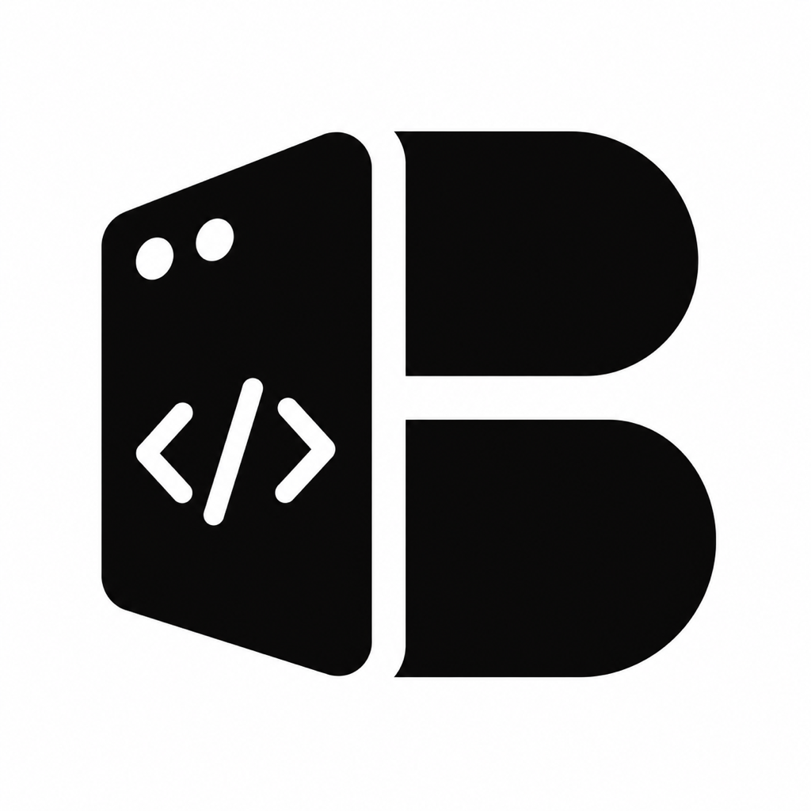

<p align="center">
  
</p>

<h1 align="center">Bonocode</h1>

<p align="center">
  <strong>A lean desktop workbench to run any coding agent CLI.</strong>
</p>

Bonocode runs the coding agents you already have installed and logged in. Tabs are sessions. The composer is the input. It does not sell tokens.

## What it keeps

- Agent chat, with each session in its own tab.
- Files and changes for the project you're working in.
- A terminal.
- A git panel for the current branch and its pull request: merge, squash, rebase, draft, ready, close and reopen, plus the PR's CI checks with failure logs.

## Supported harnesses

Install and log in to at least one. Bonocode probes for each CLI at startup and disables any it can't find.

- [Claude Code](https://claude.com/product/claude-code) - `claude auth login`
- [Codex](https://developers.openai.com/codex/cli) - `codex login`
- [Cursor CLI](https://cursor.com/cli) - `agent login`
- [Grok Build](https://docs.x.ai/build/overview) - `curl -fsSL https://x.ai/cli/install.sh | bash` then `grok login`
- [OpenCode](https://opencode.ai) - `opencode auth login`
- [Antigravity](https://antigravity.google/docs/cli-install) (macOS/Linux) - `curl -fsSL https://antigravity.google/cli/install.sh | bash`, then run `agy` once to sign in
- [Pi](https://pi.dev/) - `npm install -g @earendil-works/pi-coding-agent`
- [omp](https://omp.sh) - `curl -fsSL https://omp.sh/install | sh`
- [fx](https://fx.sh) - `curl -fsSL https://fx.sh/setup.sh | bash` then `fx login`
- [Hermes Agent](https://github.com/NousResearch/hermes-agent) - macOS/Linux: `curl -fsSL https://hermes-agent.nousresearch.com/install.sh | bash`; Windows PowerShell: `iex (irm https://hermes-agent.nousresearch.com/install.ps1)`; then run `hermes model`

## Build from source (macOS)

Requires Node.js 20+ and a current stable Rust toolchain.

```bash
npm ci
npm run tauri dev
```

To build the app bundle and disk image:

```bash
npm ci
npm run tauri build
```

Output goes to `target/release/bundle/`. Linux and Windows builds use `npm run build:linux`, `npm run build:fedora`, or `npm run build:windows`.

This is very early and you should expect bugs. Contributions are welcome; see [CONTRIBUTING.md](CONTRIBUTING.md).

## Credit and license

Bonocode is a fork of [MonoCode](https://github.com/hardbeat920/monocode) v0.6.0, used under the MIT License. See [LICENSE-MONOCODE](LICENSE-MONOCODE).

Bonocode is licensed under the [Apache License 2.0](LICENSE). Provider names and logos are trademarks of their owners - see [NOTICE](NOTICE).
